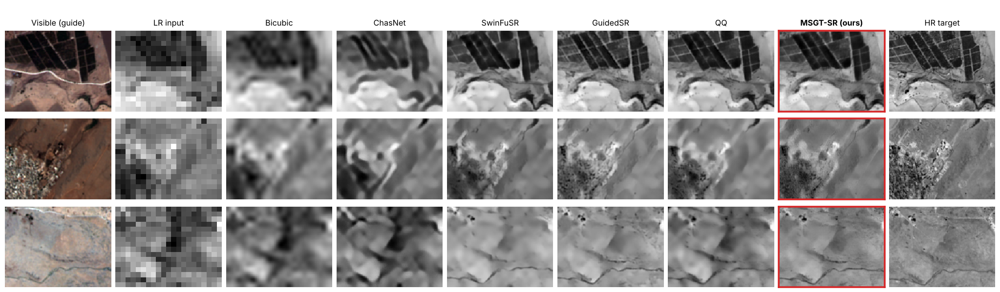
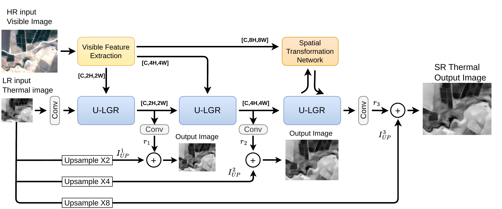
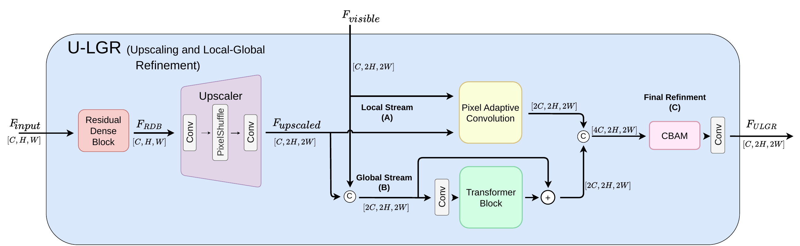
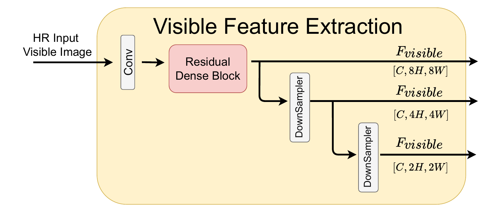
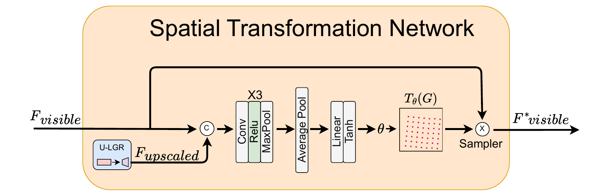
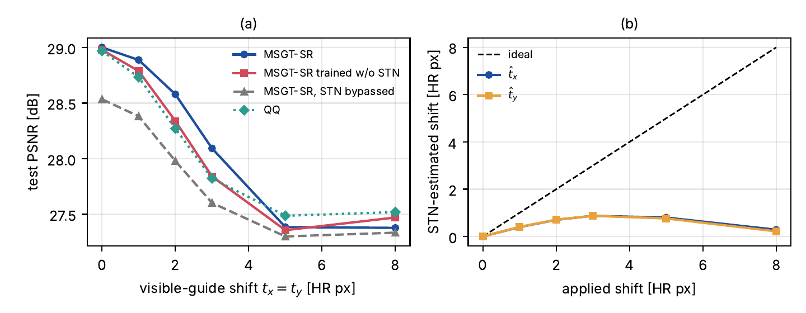

<div align="center">

# MSGT-SR: Multiscale Guided Thermal Super Resolution

**Liron Zilberberg, Navot Oz, David Mendlovic, Iftach Klapp**

*Image and Vision Computing* (under review)

[Dataset](https://drive.google.com/drive/folders/1BPBubCvXIbHSIz8xAgstLAkuPvYLqvf8) ·
[Pretrained model](https://github.com/lironzi/MSGT-SR/releases) ·
[Citation](#citation)

</div>

<p align="center">
  
</p>

**MSGT-SR** super-resolves an aerial thermal image by **×8** with the help of a high-resolution visible
image (Sentinel-2, 10 m). It is designed for nanosatellite thermal imaging, where the thermal sensor
has a much coarser resolution than the available visible data.

- **Multiscale guidance:** the visible features are fused at ×2, ×4 *and* ×8, not just once.
- **Progressive upscaling:** three ×2 steps, each supervised by its own loss.
- **Built-in alignment:** a spatial transformer compensates small shifts between the two modalities,
  which come from different platforms and dates.
- **Small and fast:** 9.34 M parameters and 22.6 ms per patch, about 14× faster than the strongest
  guided baseline, with the best fidelity of the compared methods.

---

## Architecture

<p align="center">
  
</p>

The thermal LR input is upscaled by three **U-LGR** blocks (Upscaling and Local-Global Refinement),
each by ×2. The **Visible Feature Extraction (VFE)** block provides visible features at the matching
scale for each block. Each scale predicts a residual that is added to a nearest-neighbour upsampled
copy of the LR input, giving outputs at ×2, ×4 and ×8. At ×8, a **Spatial Transformation Network (STN)**
aligns the visible features with the thermal features.

### U-LGR block

<p align="center">
  
</p>

1. **Deep features:** Residual Dense Block (8 layers, growth rate 64).
2. **Upscaling:** convolution to 4C channels → PixelShuffle (×2) → convolution.
3. **Cross-modal fusion,** in two parallel streams:
   - **Local stream (A):** Pixel-Adaptive Convolution, with kernels steered by the visible features (edge-aware).
   - **Global stream (B):** a Restormer transformer block on the concatenated thermal and visible features (long-range context).
4. **Refinement (C):** CBAM (channel and spatial attention), then a convolution back to C channels.

<details>
<summary><b>Visible Feature Extraction and STN</b></summary>
<br>
<p align="center"></p>
<p>The visible bands (B2, B3, B4) go through a convolution and an RDB. A shared stride-2 downsampler
provides the features for the ×4 and ×2 scales.</p>
<p align="center"></p>
<p>The STN regresses a translation (bounded to ±10 HR pixels) from the thermal and visible features
and resamples the visible features before the last fusion.</p>
</details>

**Loss**

$$\mathcal{L}=\sum_{i=1}^{3}\alpha_i\left\|I_{HR}^{i}-\left(I_{UP}^{i}+r_i\right)\right\|_1+\lambda\,\mathcal{L}_{VGG}\left(I_{HR}^{3},\,I_{UP}^{3}+r_3\right),\qquad \alpha_i=1,\ \lambda=0.05$$

---

## Results

Test session `111022_3`: a geographically separate block, 500 crops, values in raw sensor counts.

| Model | Guide | PSNR [dB] ↑ | MAE ↓ | SSIM ↑ | DISTS ↓ | Params | Latency [ms] |
|---|:-:|:-:|:-:|:-:|:-:|:-:|:-:|
| Bicubic | – | 27.72 | 40.55 | 0.658 | 0.397 | – | – |
| ChasNet | – | 28.19 | 38.34 | 0.682 | 0.339 | 5.43 M | 67.4 |
| SwinFuSR | ✓ | 28.61 | 36.73 | 0.706 | 0.264 | 0.97 M | 66.0 |
| GuidedSR | ✓ | 28.95 | 35.59 | 0.723 | **0.229** | 133.2 M | 51.5 |
| QQ | ✓ | 28.97 | 35.34 | 0.724 | 0.247 | 62.78 M | 318.9 |
| **MSGT-SR (ours)** | ✓ | **29.04** | **35.14** | **0.727** | 0.230 | 9.34 M | **22.6** |

All baselines were retrained on the same data, with the same split and degradation. Latency is
measured on an NVIDIA V100 in FP32, batch 1, for a 128×168 output.

### Robustness to misalignment

<p align="center">
  
</p>

The visible guide is shifted on purpose. The STN keeps MSGT-SR ahead for residual misalignments up
to about 3 HR pixels.

---

## Getting started

### Installation

```bash
git clone https://github.com/lironzi/MSGT-SR.git
cd MSGT-SR
pip install torch torchvision          # choose the build for your CUDA: https://pytorch.org
pip install -r requirements.txt
```

Tested with Python 3.8–3.11 and PyTorch 2.x.

### Data

Download the dataset from
**[Google Drive](https://drive.google.com/drive/folders/1BPBubCvXIbHSIz8xAgstLAkuPvYLqvf8)**
and place it in `Data/`:

```
Data/
├── 111022_1/      train
├── 111022_2/      train
├── 20230908_1/    train
├── 301121_1/      validation
└── 111022_3/      test
    ├── band_2.tiff       Sentinel-2 B2 (blue)
    ├── band_3.tiff       Sentinel-2 B3 (green)
    ├── band_4.tiff       Sentinel-2 B4 (red)
    └── mosaic_pan.npy    thermal mosaic (raw counts)
```

Crops of 256×336 are drawn on the fly (`Dataset.py`). The HR target is the crop downsampled ×2
(128×168), and the LR input is a further ×8 downsampling (16×21). Both use bicubic interpolation with
anti-aliasing. Each session is standardised with its own statistics.

### Pretrained model

Download `epoch_32.pth` from [Releases](https://github.com/lironzi/MSGT-SR/releases) into `runs/paper/`.

```python
import torch
from Model.MSGNet_w_F_Full import Net

net = Net().eval()
ck = torch.load("runs/paper/epoch_32.pth", map_location="cpu")
sd = ck.get("model_state_dict", ck)
net.load_state_dict({k.replace("module.", "", 1): v for k, v in sd.items()})

# thermal LR: [B,1,16,21], visible: [B,3,128,168], both standardised
sr_x2, sr_x4, sr_x8 = net(thermal_lr, visible)
```

### Training

```bash
python train.py --config configs/msgtsr.yaml
```

The output goes to `runs/<run_name>_<date-time>/`: `best.pth` (lowest validation loss), `last.pth`,
`train_log.txt` and `val_log.csv`.
- **Resume:** add `resume_path: "runs/<run>/last.pth"` to the config.
- **Low GPU memory:** set `accum_steps: 2`. The effective batch stays 64.

### Evaluation

```bash
python eval_ablation.py --paper_ckpt runs/paper/epoch_32.pth   # pretrained model + any runs in runs/
python eval_ablation.py --quick                                 # 2-minute smoke test
```

The script reports:
- PSNR, MAE with a bootstrap 95% CI, SSIM and DISTS, on the test and validation sessions;
- paired per-crop tests (bootstrap CI and Wilcoxon);
- results by distance from the training block;
- the visible-shift sweep and latency.

Output goes to `results/ablation/`.

---

## Ablation study

```bash
bash run_ablation.sh 1 0,1,2,3,4,5    # 6 runs, one GPU each
bash run_eval.sh 0                    # evaluate all runs on GPU 0
python make_fig7.py                   # loss-weight comparison figure
```

| Config | What changes |
|---|---|
| `A1_full_w111` | MSGT-SR, loss weights [1, 1, 1] (paper setting) |
| `A2_full_w039_18` | loss weights [0.3, 0.9, 1.8] |
| `A3_full_w003` | ×8 loss only [0, 0, 3] |
| `B1_single_guidance_w003` | visible guidance only at ×8, progressive upscaling kept |
| `B2_oneshot_w003` | one ×8 upsampling step, guidance once |
| `C1_stn_off_w111` | trained without the STN |

## Repository structure

```
MSGT-SR/
├── Model/
│   ├── MSGNet_w_F_Full.py   MSGT-SR: U-LGR, Fuser, STN
│   ├── MSGNet_ablation.py   architecture variants (B1, B2)
│   ├── PAC.py  RDN.py  AttentionBlock.py  attention.py
├── misc/
│   ├── trainer.py           training loop
│   ├── MultiScaleLoss.py  vgg_perceptual_loss.py
│   └── eval_extras.py       per-crop metrics, shift sweep, latency
├── configs/                 msgtsr.yaml + ablation/*.yaml
├── Dataset.py               data loader and degradation
├── DISTS.py, weights.pt     DISTS metric
├── train.py  eval_ablation.py  make_fig7.py
└── assets/                  figures for this page
```

## Acknowledgements

This work was funded by the Israel Ministry of Science and Technology (grant no. 3-17381).

The code builds on ideas or code from
[PAC](https://github.com/NVlabs/pacnet),
[RDN](https://github.com/yulunzhang/RDN),
[Restormer](https://github.com/swz30/Restormer),
[CDDFuse](https://github.com/Zhaozixiang1228/MMIF-CDDFuse),
[CBAM](https://github.com/Jongchan/attention-module) and
[DISTS](https://github.com/dingkeyan93/DISTS).
Please respect their licences.

## Citation

```bibtex
@article{zilberberg_msgtsr,
  title   = {{MSGT-SR}: Multiscale Guided Thermal Super Resolution},
  author  = {Zilberberg, Liron and Oz, Navot and Mendlovic, David and Klapp, Iftach},
  journal = {Image and Vision Computing},
  note    = {under review},
  year    = {2026}
}
```

## Licence

The code is released under the MIT licence (see `LICENSE`). The dataset is distributed separately
through the link above.
